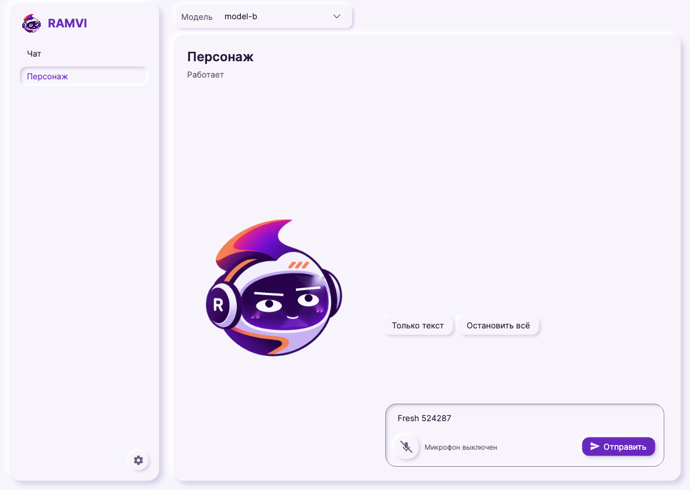
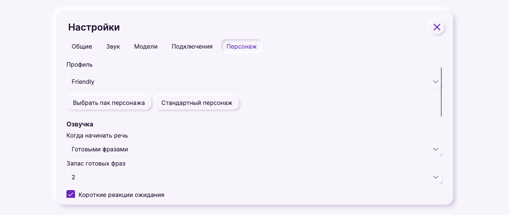

# Character 9.13: управление и подача речи

2026-11-19. Первичная проверка на Mac; последующая поставка Windows описана в [CHARACTER_WINDOWS_DEPLOY.md](CHARACTER_WINDOWS_DEPLOY.md).

## Итоговое размещение и общий интерфейс

После уточнений владельца в «Настройки → Персонаж» остались профиль,
озвучка, пак и диагностика. Распознавание настраивается только в общей
вкладке «Звук»; сохранение обновляет возможности голосовой сессии Character,
не запуская микрофон. Озвучка показана обычным открытым блоком, без аккордеона.

Активная модель выбирается один раз над рабочей областью Chat/Agent/Character.
Отдельные списки Character и Agent удалены. Изменение общего выбора обновляет
обе модели клиента; сохранённый выбор Character не переопределяет общий.
Выбор модели до открытия Character не активирует модуль. Во время генерации
общий список недоступен.

Поле ввода Character использует `composer`, `bare`, размеры текста и кнопки
с иконками Chat/Agent. Микрофон находится в нижней строке; выключенный
перечёркнут. Enter отправляет сообщение, Shift+Enter добавляет новую строку.
Предпросмотр и переключатель показа удалены; персонаж показывается всегда.
Открытие настроек из чата не переключает раздел и не стирает черновик.

93 проверки Character/Settings/Agent/Chat/клавиатуры прошли. В том числе:
выбор model-b при сохранённой model-a в Character, отправка выбранной модели,
обновление общих настроек распознавания без старта записи, клавиатурный ввод,
смена значка микрофона, поле ввода и баннер отказа при высоте окна 500.

Далее — журнал первоначальной реализации до переноса настроек.

## Что доступно в разделе

Существующие выборы профиля, LLM и голоса/TTS дополнены настройками распознавания,
подачи речи, выбором пака, скрытием изображения, остановкой и диагностикой.
Предпросмотр движений убран в сворачиваемый блок. Настройки и длинный черновик
не вытесняют поле ввода за нижнюю границу короткого окна.

Выбранный пак и показ изображения сохраняются в данных Character
(`presentation.json`, также в checkpoint). Некорректный пак показывает ошибку;
есть явный возврат к стандартному. Изменение изображения не отменяет текст,
не переписывает профиль и не управляет звуком. Пути представления не входят
в контекст LLM. Текстовая активация модуля не загружает изображения или устройства.

Распознавание использует общие с Чатом настройки микрофона, языка, локальной
модели/API, отдельный ключ STT и прежние загрузку/проверку. Это явно подписано.
Данные загружаются по кнопке; смена списка ничего не применяет до сохранения.
Сохранение останавливает свою голосовую сессию Character, не меняет остальные
настройки приложения и обновляет предупреждение об отправке аудио на сервер.
Ключи STT и TTS по-прежнему разделены.

«Только текст» останавливает голосовую сессию/озвучку и сохраняет отключённую
озвучку, сохраняя текущий текст, профиль и черновик. «Остановить всё» сначала
останавливает голосовой вход, затем текущий ответ и свой аудиовывод. Скрытие
изображения освобождает renderer/таймер, не выключая текстовую часть.

Диагностика показывает имеющиеся замеры распознавания, первой готовой текстовой
фразы, подготовки PCM и начала DAC-расписания, эмоцию/ID звучащего сегмента и
краткую категорию реакции. Начало DAC помечено приблизительным; это не
акустическое измерение. Неизвестные времена не заменяются придуманными числами.
Сведения о цене/ограничениях TTS остаются в его настройках.

## Подача ответа

Политика хранится отдельно в `delivery.json`, выбор недавних реакций — в
`reaction_history.json` внутри данных модуля.

- «Готовыми фразами»: выбранный запас готовых сегментов перед началом; короткий
  ответ сбрасывает ожидание запаса после проверенного окончания генерации.
- «После полного ответа»: до окончания проверенного ответа звук не начинается,
  текстовые события доступны раньше. Удерживается ограниченное число сегментов;
  нет ожидания заполнения маленькой аудиоочереди внутри замка диалога.

Промпт просит завершённые предложения/смысловые единицы. Непроверенные JSON-куски
не озвучиваются. «Полный ответ» означает готовность всего текста; длинный ответ
всё равно состоит из ограниченных TTS-запросов, а не бесконечного запроса.
Отмена/ошибка удаляют и отложенные фразы. Повторы не создают новое озвучивание.

Настраиваемые значения, **не результаты измерений**: запас 1/2/3 готовых сегмента,
ожидание реакции от 0.6 с после начала ответа, до 8 основных сегментов.
Одна локальная вступительная реплика имеет отдельное место, не отнимая один из
основных сегментов; дополнительные вступления не разрешены.

## Разные реакции по контексту

В первом валидированном start-record основная LLM может указать одну категорию:
обдумывание, объяснение, расчёт, формулировка текста, код, сравнение, план или
поддержка, и язык RU/EN. При быстрых, срочных или неоднозначных случаях промпт
просит `none`. Это тот же запрос с текущим контекстом/профилем, без отдельного
LLM-вызова ради реакции. Ключевые слова пользователя не используются для
автоматического угадывания категории в модуле.

В банке **48 текстовых фраз**: варианты категорий RU/EN. Модуль выбирает давно
не использованный вариант и сохраняет недавний выбор; повтор одной категории
и перезапуск не возвращают одну и ту же реплику подряд. Если основной ответ
уже готов по выбранному правилу, вступление пропускается. Реплика не попадает
в историю как содержательный ответ или память и не даёт прав на действия.

Сейчас реакции доступны только при выбранном системном TTS и используют его
выбранный голос. При внешнем TTS нет скрытого системного fallback или лишнего
платного запроса. Аудио реплик **не подготовлено заранее**: оно синтезируется
при запуске. До первого вывода основной модели и затем во время синтеза возможна
тишина. Контекстная классификация настоящей LLM пока не оценена; банк/ротация
и передача уже выбранной категории проверены отдельно. Это механизм, а не
заявление об уместности каждой будущей реакции.

## Проверки и данные

- Связанные Python-наборы Character, речь/отказы/очереди/часы, голосовые сессии,
  Module Core/Data/API и Sections: **201 passed**.
- Character + Sections в Avalonia: **58 passed**. Дополнительно повторён сценарий
  короткого окна для снимков: **1 passed**. Проверены сохранение настроек только
  по явной команде, отсутствие запуска микрофона при чтении настроек, сохранность
  остальных AppSettings, режим текста, скрытие/возврат renderer и смена языка
  подписей политики без изменения её кодов.
- Ruff/format по затронутым Python-файлам прошли. Mypy по Character, speech,
  voice/session и новому тесту: **24 файла без ошибок**. Это проверка указанной
  области, не заявление о полном CI.
- RU/EN: **769 ключей, 0 ошибок**.
- Wheel Character/Service собраны; вне checkout проверены импорт, ресурсы,
  новый протокол и checkpoint представления без импорта аудио/GPU-библиотек:
  [wheel.json](character_checks/ui/wheel.json).

Отрицательные контроли: постоянно одинаковая реплика не проходит ротацию;
озвучивание всех фраз сразу не проходит режим полного ожидания; никогда не
озвучивающая стратегия не проходит flush короткого ответа и живой вывод.
Неизвестная категория/политика отклоняется; внешний TTS не получает вступление;
повтор вступления и девятый основной сегмент запрещены. Ранний поток отдельно
проверен с запасом 1; запас 2/3 — другой выбранный режим, а не регрессия потока.

[Компактное окно](character_checks/ui/compact.png),
[распознавание](character_checks/ui/recognition.png),
[подача речи](character_checks/ui/delivery.png). Снимки просмотрены.

Живой [native_delivery.py](character_checks/ui/native_delivery.py) проверил три
пары «локальная реакция → новый ответ», с пересозданием SpeechOutput и сохранением
истории выбора. Категории **заданы скриптом**, а не получены от настоящей LLM:

| Категория | Реально запрошенная реплика | Основной ответ |
|---|---|---|
| write | Подберу формулировку. | завершён |
| calculate | Сейчас посчитаю. | завершён |
| write | Сейчас набросаю вариант. | завершён |

В каждом случае получено ненулевое окно DAC для реакции и завершён основной
вывод. Все собственные workers остановлены. Данные:
[mac.json](character_checks/ui/mac.json).

## Что остаётся открытым

В 9.22/9.23 нужны выбор реакции настоящей моделью на новых/неоднозначных
запросах, слабое железо, предварительный синтез/кэш выбранного голоса, подготовка
следующей фразы и измерение пауз. Текстовый запас ещё не гарантирует ровную речь:
сейчас TTS отдельных сегментов запускается последовательно. Мгновенный старт,
слышимость без разрывов, качество интонации и целевые задержки не объявляются
достигнутыми. Полная живая проверка приложения/Windows остаётся частью экзамена.
